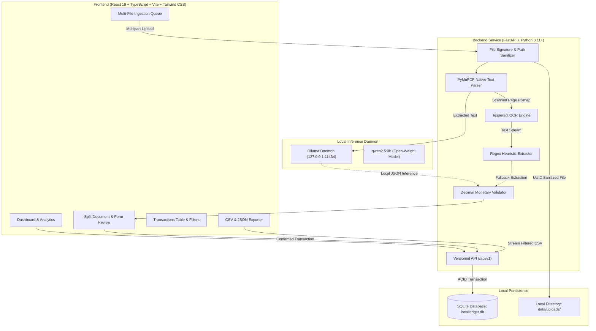

# LocalLedger AI

> **Your receipts. Your data. Your AI. Your computer.**

LocalLedger AI is a production-quality, local-first invoice and receipt management application designed for freelancers, students who freelance, independent professionals, and small business owners.

Built for **Hacktoberfest Week 2: Side Hustle**, LocalLedger AI solves expense tracking without sacrificing financial privacy. Sensitive financial documents never leave your machine: zero hosted LLM calls, zero cloud OCR APIs, zero remote analytics, and zero subscription AI fees.

---

## 1. Problem Statement

Most modern expense and accounting applications require uploading sensitive receipts—containing vendor names, tax IDs, home addresses, customer details, and personal expenditure patterns—to multi-tenant cloud servers and commercial third-party LLMs.

For independent contractors and privacy-conscious professionals, this introduces:
- **Privacy & Security Risks**: Leaking customer or vendor data to third-party model trainers.
- **Vendor Lock-in & Costs**: Paying recurring cloud API per-token and per-page rates.
- **Fragility**: Becoming unable to process invoices when offline or when external cloud APIs suffer outages.

LocalLedger AI solves this by keeping the entire document processing, OCR, AI interpretation, and database stack 100% on the user's computer.

---

## 2. Target Users

- **Freelancers & Solopreneurs**: Track project and client expenses with instant tax categorization.
- **Students Who Freelance**: Organize side-hustle expenses on everyday laptop hardware without paid API subscriptions.
- **Independent Contractors**: Maintain an audit-ready local ledger of invoices with content deduplication.
- **Privacy-Conscious Professionals**: Keep personal financial habits and client invoice details strictly sovereign.

---

## 3. Feature Highlights

- **Local Document Ingestion**: Supports PDF documents, PNG, JPEG, and WebP receipts with client-side drag-and-drop.
- **Embedded PDF Extraction First**: Extracts native digital text layers with PyMuPDF before invoking OCR.
- **Local OCR Engine**: Integrated Tesseract OCR running on your local machine with automatic fallback if binary is absent.
- **Local AI Interpretation (Ollama)**: Structured financial extraction using locally hosted open-weight models (`qwen2.5:3b`).
- **Resilient Fallback Mode**: If Ollama is offline or unavailable, the system transparently defaults to rule-based heuristic OCR extraction.
- **Split-Screen Receipt Review**: Inspect document images or PDFs side-by-side with an editable financial form showing provenance confidence.
- **Mathematical Integrity Validation**: Flags discrepancies when Subtotal + Tax does not equal Total, accounting for tips, discounts, and rounding.
- **Decimal-Safe Financial Arithmetic**: Eliminates IEEE 754 floating-point errors using exact Python `Decimal` and SQLite `Numeric(12, 2)`.
- **Multi-Currency Segregation**: Group transactions cleanly by ISO currency (USD, EUR, GBP, CAD, etc.) without combining currencies into a single sum.
- **Full Ledger Controls**: Search by merchant, notes, or filename; filter by category, date range, or currency; sort, paginate, edit, and delete.
- **Analytics & Visualizations**: Interactive spending breakdowns and monthly trends powered by Recharts.
- **CSV & JSON Export**: One-click streaming CSV export for accountant handoff and complete JSON backup export.
- **Local Data Erasure**: One-click complete database wipe with explicit confirmation string verification (`DELETE LOCAL DATA`).

---

## 4. Architecture Diagram



---

## 5. Technology Stack

### Frontend
- **Framework**: React 19, TypeScript (Strict)
- **Tooling**: Vite
- **Styling**: Tailwind CSS, Lucide React icons
- **State & Routing**: React Router v6, TanStack Query v5
- **Forms & Validation**: React Hook Form, Zod
- **Visualizations**: Recharts
- **Testing**: Vitest, React Testing Library, jsdom

### Backend
- **Framework**: Python 3.11+ (tested on Python 3.13), FastAPI
- **ORM & Database**: SQLAlchemy 2.0, SQLite (PRAGMA foreign_keys=ON)
- **Migrations**: Alembic
- **Validation**: Pydantic v2, Pydantic Settings
- **HTTP Client**: HTTPX
- **Document Processing**: PyMuPDF (fitz), Pillow, pytesseract, python-multipart
- **Testing & Quality**: pytest, pytest-asyncio, Ruff linter & formatter

---

## 6. Prerequisites

- **Python**: 3.11 or newer (Python 3.13 supported)
- **Node.js**: v20 or newer with npm
- **Git**
- *(Optional, Recommended)* **Tesseract OCR**: For scanned receipts.
- *(Optional, Recommended)* **Ollama**: For local AI semantic extraction.

---

## 7. Installation Instructions

### Windows Setup

1. **Clone the repository**:
   ```powershell
   git clone https://github.com/your-username/localledger-ai.git
   cd localledger-ai
   ```

2. **Configure environment settings**:
   ```powershell
   Copy-Item .env.example .env
   ```

3. **Set up Python backend**:
   ```powershell
   python -m venv backend\.venv
   backend\.venv\Scripts\pip install -r backend\requirements.txt
   backend\.venv\Scripts\alembic upgrade head
   ```

4. **Set up React frontend**:
   ```powershell
   cd frontend
   npm install
   cd ..
   ```

### Linux & macOS Setup

1. **Clone and configure**:
   ```bash
   git clone https://github.com/your-username/localledger-ai.git
   cd localledger-ai
   cp .env.example .env
   ```

2. **Set up Python backend**:
   ```bash
   python3 -m venv backend/.venv
   source backend/.venv/bin/activate
   pip install -r backend/requirements.txt
   alembic upgrade head
   ```

3. **Set up React frontend**:
   ```bash
   cd frontend
   npm install
   cd ..
   ```

---

## 8. Ollama Installation & Model Setup

LocalLedger AI connects to your local Ollama daemon via loopback (`http://127.0.0.1:11434`).

1. Download and install Ollama from [ollama.com](https://ollama.com).
2. Download the recommended open-weight extraction model:
   ```bash
   ollama run qwen2.5:3b
   ```
3. Once downloaded, LocalLedger AI automatically detects the model and displays **Ollama AI: Online** in the top navigation bar.

> **Note**: If Ollama is not installed or the model is not downloaded, LocalLedger AI operates in **OCR-Only Mode**, parsing amounts, dates, and merchants using deterministic heuristics.

---

## 9. Tesseract OCR Installation

- **Windows**: Download and install the 64-bit installer from [UB-Mannheim Tesseract OCR](https://github.com/UB-Mannheim/tesseract/wiki). Default installation path: `C:\Program Files\Tesseract-OCR\tesseract.exe`.
- **Ubuntu/Debian**:
  ```bash
  sudo apt-get update && sudo apt-get install -y tesseract-ocr tesseract-ocr-eng
  ```
- **macOS**:
  ```bash
  brew install tesseract
  ```

---

## 10. Running the Application

### Option A: Running Locally (Recommended for Development)

Open two terminal windows:

**Terminal 1 (Backend API)**:
```powershell
# Windows
backend\.venv\Scripts\uvicorn app.main:app --reload --host 127.0.0.1 --port 8000

# Linux/macOS
source backend/.venv/bin/activate
uvicorn app.main:app --reload --host 127.0.0.1 --port 8000
```
API Documentation: [http://127.0.0.1:8000/docs](http://127.0.0.1:8000/docs)

**Terminal 2 (Frontend)**:
```bash
cd frontend
npm run dev
```
Open [http://127.0.0.1:5173](http://127.0.0.1:5173) in your browser.

### Option B: Docker Compose

```bash
docker-compose up --build
```
- Frontend: `http://127.0.0.1:5173`
- Backend: `http://127.0.0.1:8000`

---

## 11. Testing & Code Quality

### Backend Tests (pytest)
```powershell
# Windows
backend\.venv\Scripts\pytest -v

# Linux/macOS
cd backend && pytest -v
```
*Current test suite: 19 passing tests covering health, uploads, PDF extraction, OCR degradation, Ollama mocking, transaction CRUD, reports, and settings.*

### Frontend Tests (Vitest & React Testing Library)
```bash
cd frontend
npm run test
```
*Current test suite: 4 passing test files (7 tests) covering Dashboard states, Upload validation, Split Review, and Transactions.*

### Linting & Formatting
```bash
# Python (Ruff)
backend\.venv\Scripts\ruff check .
backend\.venv\Scripts\ruff format .

# TypeScript Build Check
cd frontend && npm run build
```

---

## 12. Privacy & Security Model

- **No Remote AI Fallbacks**: No code path sends data to cloud AI services.
- **Strict Loopback Binding**: Defaults to `127.0.0.1`.
- **SSRF Prevention**: The Ollama client validates and rejects any hostname other than `localhost`, `127.0.0.1`, or `host.docker.internal`.
- **Path Traversal Defense**: File paths are sanitized and resolved within `data/uploads/`.
- **Prompt Injection Hardening**: Receipt text is untrusted; prompt wrappers explicitly prohibit instruction following.
- **Safe Logging**: Full receipt contents and financial values are excluded from standard server logs.

See [docs/privacy.md](docs/privacy.md) for the complete threat model.

---

## 13. Offline Capabilities & Model Requirements

- **Setup Phase**: Internet access is required only during initial `pip install`, `npm install`, and `ollama pull qwen2.5:3b`.
- **Routine Execution**: 100% offline. Once dependencies and model weights are downloaded, LocalLedger AI runs without any internet connection.
- **Recommended Hardware**: Any modern laptop with at least 8GB RAM. `qwen2.5:3b` requires ~2.5GB of RAM/VRAM.

---

## 14. Troubleshooting

- **Ollama status shows Offline**:
  Verify the Ollama daemon is running: open a terminal and run `ollama list`. Test connection in the **Settings** page.
- **Tesseract Not Found on Windows**:
  If Tesseract is installed outside `C:\Program Files\Tesseract-OCR\tesseract.exe`, set `TESSERACT_CMD` in your `.env` file:
  ```env
  TESSERACT_CMD=D:\CustomPath\Tesseract-OCR\tesseract.exe
  ```
- **Port 8000 or 5173 already in use**:
  Update `BACKEND_PORT` or `FRONTEND_PORT` in `.env`.

---

## 15. Known Limitations

- **Single-User Architecture**: Built for solo freelancers; does not include multi-tenant role-based access control (RBAC).
- **Disk Encryption**: Files on disk are unencrypted; use OS-level BitLocker/FileVault for physical at-rest protection.
- **Handwritten Receipts**: Handwritten paper receipts with low contrast may produce partial OCR recognition; user manual review is always required.

---

## 16. Roadmap

- [ ] Multi-page receipt stitcher for folded invoices.
- [ ] Export directly to standard QIF and OFX formats for accounting software import.
- [ ] Automated periodic SQLite backup to encrypted zip archives.
- [ ] OCR bounding box visual highlighting over the receipt preview.

---

## 17. License & Contributions

- **Application License**: [MIT License](LICENSE)
- **Model License**: `qwen2.5:3b` is licensed under the Apache 2.0 open-weights license by the Qwen Team.
- **Contributions**: Contributions are welcome! See [CONTRIBUTING.md](CONTRIBUTING.md).
