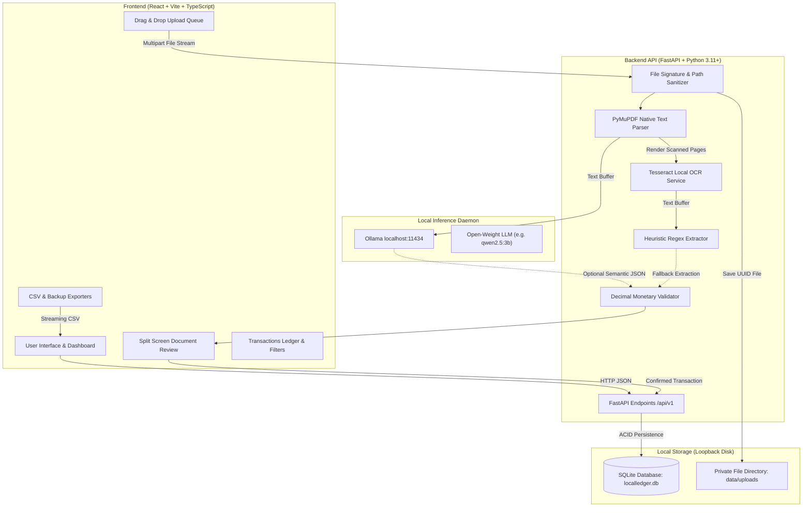

# LocalLedger AI — System Architecture

## Overview

LocalLedger AI is an offline-first, sovereign receipt and invoice processing application designed for freelancers, independent contractors, and privacy-conscious professionals. It runs entirely on the host machine without external LLM APIs, cloud OCR services, or remote analytics.

---

## Architectural Diagram

---

## Key Subsystems

### 1. Document Ingestion & Validation Pipeline
- **Magic Byte Signature Inspection**: Verifies actual file header bytes (`%PDF-`, `\x89PNG`, `\xff\xd8\xff`, `RIFF...WEBP`) rather than trusting untrusted client file extensions.
- **Path Traversal Defense**: All stored files are given deterministic UUID names and verified against the canonical upload root directory before any file access occurs.
- **SHA-256 Deduplication**: Every file content hash is calculated upon upload. If a file has already been recorded, the user is flagged with an advisory duplicate banner while retaining the option to proceed if intentional.

### 2. Dual-Engine Document Extraction
1. **PDF Embedded Layer**: First attempts lossless digital text extraction using PyMuPDF (`fitz`).
2. **Local Page Rendering & OCR**: If a page is scanned or image-based, PyMuPDF renders the page to a high-DPI pixmap locally, which is then processed by Tesseract OCR via `pytesseract`.
3. **Graceful Degradation**: If Tesseract is not installed on the system, the application catches `TesseractNotFoundError` gracefully without crashing, falling back to embedded PDF text or notifying the user in Settings.

### 3. Local AI Integration (Ollama)
- **Strict Loopback Binding**: The client only connects to `http://127.0.0.1:11434` (or `localhost`). External hosts are rejected at startup to prevent SSRF vulnerabilities.
- **Prompt Injection Defense**: Untrusted OCR text is wrapped inside strict `<RECEIPT_TEXT>` boundary delimiters with explicit system instructions prohibiting execution of any embedded commands.
- **Offline / Missing Model Fallback**: If the Ollama daemon is offline or the model is not pulled, the system seamlessly uses rule-based heuristic extraction (`ocr_rules`) with no disruption to the user.

### 4. Financial Calculation & Currency Integrity
- **Decimal-Safe Handling**: All amounts (`subtotal`, `tax`, `total`) use Python `Decimal` and SQLAlchemy `Numeric(12, 2)` to eliminate floating-point rounding errors.
- **Multi-Currency Segregation**: Currencies are grouped strictly (e.g., USD, EUR, GBP). The system never sums different currencies together without explicit exchange rate conversions.

### 5. Data Persistence
- **SQLite Engine**: Configured with `PRAGMA foreign_keys=ON` and `check_same_thread=False`.
- **Alembic Migrations**: All schema versions are tracked with reversible migration files.
